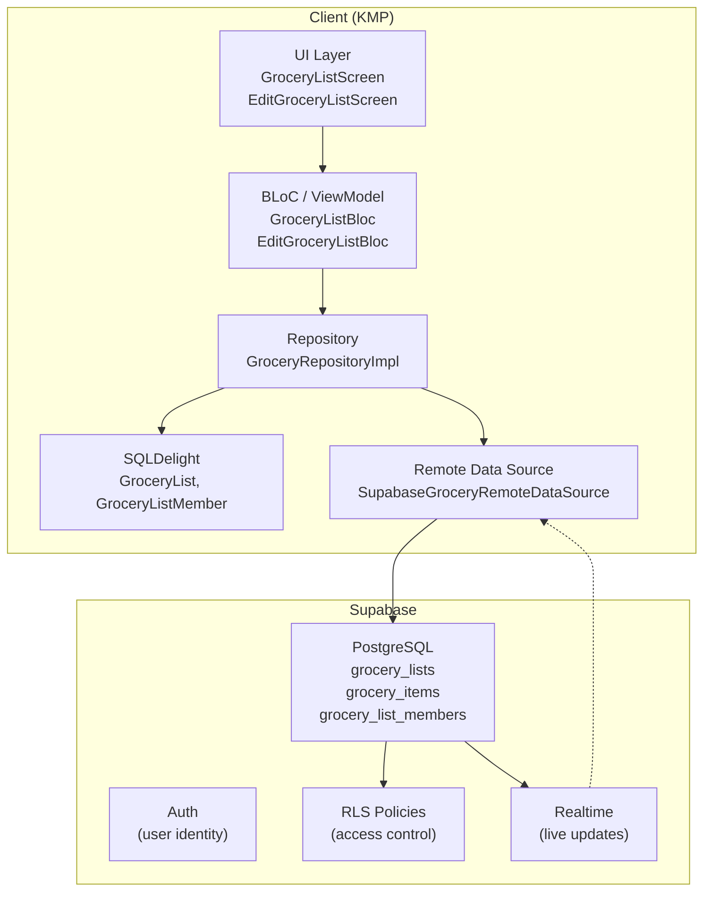
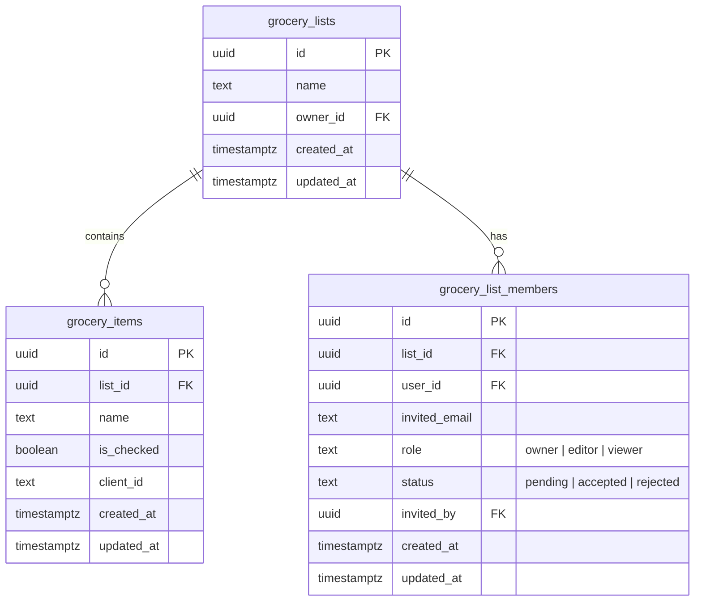
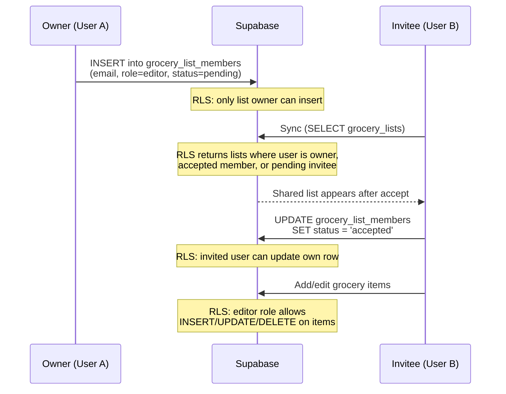

# Grocery List Collaboration

This document describes the architecture for grocery-list collaboration in Chef Mate.
(Recipe sharing is handled separately by recipe-book collaboration — see the `recipebook`
modules.)

## Overview

Collaboration lets a user share a grocery list with others by email. Each list has role-based
access control (Owner, Editor, Viewer) enforced at both the UI and database levels via Supabase
Row Level Security (RLS).

## Roles

| Role | Grocery Lists |
|------|--------------|
| **Owner** | Full control: rename, delete list, manage items, invite/remove collaborators |
| **Editor** | Add, check, delete items. Cannot rename or delete the list |
| **Viewer** | Read-only. Cannot add, check, or delete items |

## Data Model

### Supabase Tables

### Local SQLDelight Schema

The local database mirrors the remote collaboration state with these additions:

**GroceryList** (new columns):
- `ownerId` - remote user ID of the list owner
- `role` - current user's role (`owner`, `editor`, `viewer`)
- `isShared` - whether this list was shared by another user

**GroceryListMember** (new table): local cache of collaborators per list.

## Invitation Flow

For users who don't have an account yet, the `invited_email` is stored with `user_id = NULL`. A
database trigger on `auth.users` INSERT automatically migrates pending invitations when the user
signs up.

### Email notification on invite

An invitee is emailed out-of-band when they're invited, so they don't have to already be in the
app to discover a pending invite. Because every client inserts the invite directly into the member
table, this is done entirely on the backend and requires no app-side code:

- An `AFTER INSERT` trigger on `grocery_list_members` (and `recipe_book_members`) calls
  `notify_invite_email()`, which fires `pg_net` at the `send-invite-email` edge function for each
  new `status='pending'` row. `net.http_post` is async, so a slow or failing email never blocks or
  rolls back the invite insert.
- The edge function resolves the list/book name and the inviter's display name with the
  service-role client and sends the mail via Resend.
- **Re-invites don't re-email**: the `UNIQUE(list_id, invited_email)` constraint makes a repeat
  invite an UPDATE, not an INSERT, so the trigger doesn't fire.

**Setup:** deploy the function (`supabase functions deploy send-invite-email`), set its secrets
(`RESEND_API_KEY`, `INVITE_HOOK_SECRET`; `SUPABASE_URL` / `SUPABASE_SERVICE_ROLE_KEY` are
auto-injected), verify the Resend sending domain, and store two Vault secrets the trigger reads —
`project_url` and `invite_hook_secret` (the latter matching `INVITE_HOOK_SECRET`). Vault secrets go
through the Dashboard's SQL Editor, not the CLI. See the header of
`supabase/migrations/20260707_invite_email_notification.sql` for the exact `vault.create_secret`
calls, how to verify they landed, and how to rotate `invite_hook_secret` (via `vault.update_secret`
— `create_secret` errors on a duplicate name).

The verified sending domain is `plusmobileapps.com` and the default sender is
`noreply@plusmobileapps.com` (see `DEFAULT_FROM` in the edge function; override at runtime with the
`RESEND_FROM` secret). Resend authorizes any address at that exact domain — a subdomain such as
`chefmate.plusmobileapps.com` would need separate verification.

## Sync Strategy

The existing offline-first sync is extended for collaboration:

1. **Pull phase** (all accessible lists, runs first):
   - `fetchAccessibleGroceryLists()` uses a filter-less SELECT — RLS returns owned + shared lists
   - Each pulled list is tagged locally with `ownerId`, `role`, and `isShared`; an unsynced local
     list with the same name is linked instead of duplicated
   - Local lists whose `remoteId` no longer comes back are pruned (deleted on another device)

2. **Push phase** (owned lists only):
   - Push unsynced/dirty lists where `role = 'owner'`
   - Shared lists are never pushed as new creations

3. **Member sync**: members are fetched and cached in `GroceryListMember`

4. **Item sync** (unchanged): items sync per-list; RLS authorizes shared-list items.

## RLS Policy Summary

| Table | SELECT | INSERT | UPDATE | DELETE |
|-------|--------|--------|--------|--------|
| `grocery_lists` | owner OR accepted member OR pending invitee | owner only | owner OR editor member | owner only |
| `grocery_items` | user has list access | owner OR editor | owner OR editor | owner OR editor |
| `grocery_list_members` | user has list access OR invited user | list owner only | invited user OR owner | owner OR self (leave / decline) |

## UI Components

- **List selector** (responsive): a bottom-sheet modal on phones, an anchored dropdown on
  tablets/desktop. Split into "My Lists" and "Shared with me"; shared lists show a badge. Each row
  has an edit (pencil) icon that opens the Edit Grocery List screen.
- **Edit Grocery List screen** (full screen): rename the list, delete it behind a confirmation
  dialog (owner only), and manage collaboration. Collaboration is auth-gated — signed-out users
  see a message with Sign in / Sign up; authenticated owners invite by email and remove
  collaborators.
- **Permission gating**: viewers don't see the add-item input.

### Key Files

| Concern | Path |
|---------|------|
| Supabase migration | `supabase/migrations/20260425_add_collaboration.sql` |
| Pending-invite access + collaborator RPCs | `supabase/migrations/20260612_grocery_pending_invite_access.sql` |
| Invite-email migration | `supabase/migrations/20260707_invite_email_notification.sql` |
| Invite-email edge function | `supabase/functions/send-invite-email/index.ts` |
| SQLDelight migration | `client/database/core/src/commonMain/sqldelight/.../database/6.sqm` |
| Member queries | `client/database/core/src/commonMain/sqldelight/.../GroceryListMember.sq` |
| Collaboration models | `client/grocery/data/public/.../CollaborationModels.kt` |
| Remote member model | `client/grocery/data/public/.../remote/RemoteGroceryListMember.kt` |
| Repository | `client/grocery/data/impl/.../GroceryRepositoryImpl.kt` |
| List BLoC | `client/grocery/core/public/.../list/GroceryListBloc.kt` |
| Edit BLoC | `client/grocery/core/public/.../edit/EditGroceryListBloc.kt` |
| Edit screen | `client/grocery/core/public/.../edit/EditGroceryListScreen.kt` |
| DI bindings | `client/database/core/.../di/DatabaseComponent.kt` |
